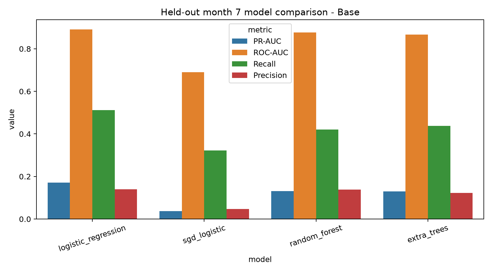
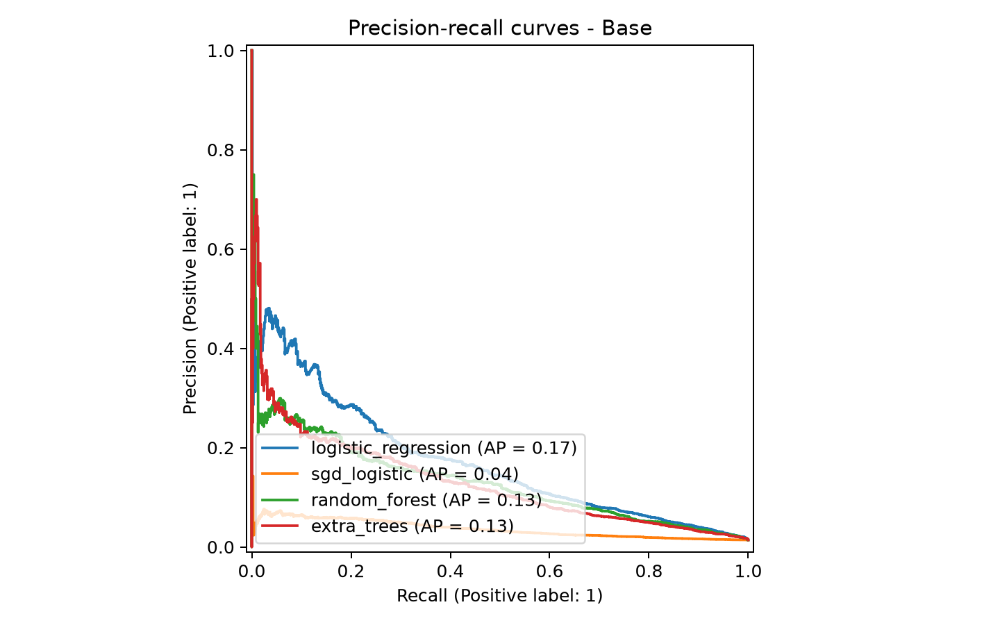

# AI4Cyber: Bank Account Opening Fraud Screening

This repository contains the machine-learning implementation for detecting potentially fraudulent bank
account applications. It trains and compares four classifiers on all six datasets in the Bank Account
Fraud (BAF) dataset, evaluates the models using a time-based split, performs exploratory clustering, and
serves the selected model through a FastAPI application.

The system is ML-only. It does not contain a chatbot or an LLM. A model score is a screening signal, not
a verified probability of fraud, and the prototype does not approve, reject, or block real applications.

> **Academic integrity:** the supplied assignment brief says generative AI must not be used to generate
> assessment material. Confirm permitted use with the tutor, disclose assistance where required, and
> make sure every team member can explain and reproduce the submitted work.

## Dataset source

- [Bank Account Fraud Dataset Suite (NeurIPS 2022) on Kaggle](https://www.kaggle.com/datasets/sgpjesus/bank-account-fraud-dataset-neurips-2022)
- [Official BAF documentation, datasheet, and citation](https://github.com/feedzai/bank-account-fraud)

The BAF data is provided under CC BY-NC-SA 4.0. Keep the source, licence, and citation with any analysis
or derived dataset, and do not commit the large raw CSV files to this repository.

## Quick start

```bash
git clone https://github.com/KennyDao1324/ai4cyber-fraud.git
cd ai4cyber-fraud
conda env create -f environment.yml
conda activate ai4cyber-fraud
pytest -q
python -m uvicorn ai4cyber.api:app --host 127.0.0.1 --port 8010
```

Open <http://127.0.0.1:8010/docs> to use the API. The small selected production model is stored in the
repository, so inference and the API work after the dependencies are installed. The raw datasets are only
needed when retraining.

## Standard team folder layout

| Folder | Purpose |
| --- | --- |
| `checkpoint/` | Production model and model-card links |
| `dataset/` | Direct `.csv` access to Base and Variants I-V |
| `evaluation/` | Metrics, CSV summaries, and evaluation charts |
| `preprocess_data/` | Dataset validation and profiling entrypoint |
| `preprocessed_df/` | Train-ready `.csv.gz` tables with split labels |
| `training_model/` | Main model-training entrypoint |
| `utils/` | Shared paths used by the workflow scripts |

### Why some files are intentionally short

Some files in these folders contain only one or two lines because they support the project structure rather
than implement the machine-learning pipeline:

- `.gitkeep` keeps an otherwise empty output folder visible in Git.
- `__init__.py` marks a directory as a Python package and may only contain a package description or version.
- Folder-level `README.md` files briefly describe what belongs in that folder.
- Small CSV and JSON files are generated summaries or metadata, not Python source code.

The main implementation is under `src/ai4cyber/`. The scripts in `preprocess_data/`, `training_model/`, and
`evaluation/` are convenient entrypoints that call that shared implementation without duplicating it.

Use the standardized workflow from the project root:

```bash
python preprocess_data/run.py
python training_model/train.py
python evaluation/evaluate.py
```

## Project map

| Location | Purpose |
| --- | --- |
| `src/ai4cyber/data.py` | Dataset validation, temporal splits, and preprocessing |
| `src/ai4cyber/training.py` | Classifier training, evaluation, selection, and artifact export |
| `src/ai4cyber/clustering.py` | MiniBatch K-Means experiment |
| `src/ai4cyber/eda.py` | Exploratory data analysis charts |
| `src/ai4cyber/metrics.py` | Classification metrics and threshold selection |
| `src/ai4cyber/inference.py` | Command-line prediction and local feature effects |
| `src/ai4cyber/api.py` | FastAPI endpoints |
| `src/ai4cyber/decision.py` | Score-to-review-label rules |
| `configs/training.json` | Real experiment settings and sample limits |
| `configs/demo_training.json` | Small smoke-test settings |
| `examples/sample_application.json` | Example prediction input |
| `tests/` | Unit, API, and end-to-end tests |
| `notebooks/baf_profiling.ipynb` | Reproducible Base and Variants I-V profiling notebook |
| `docs/DATASET_PROVENANCE.md` | Source, version, licence, citation, and variant rationale |
| `docs/canvas_dataset_archive.json` | Hash and integrity evidence for the separately supplied course archive |
| `docs/LEAKAGE_CHECKLIST.md` | Auditable data-leakage controls |
| `outputs/TRAINING_RUN_LOG.md` | Consolidated experiment log for the team |
| `outputs/profiling/` | Per-dataset dtypes, missing codes, hashes, and Base comparison |
| `outputs/base/` | Base dataset metrics, CSV files, and charts |
| `outputs/variant_i/` | Variant I metrics, CSV files, and charts |
| `outputs/variant_ii/` | Variant II metrics, CSV files, and charts |
| `outputs/variant_iii/` | Variant III metrics, CSV files, and charts |
| `outputs/variant_iv/` | Variant IV metrics, CSV files, and charts |
| `outputs/variant_v/` | Variant V metrics, CSV files, and charts |
| `artifacts/model_card.json` | Model configuration, selection, and evaluation record |
| `artifacts/production_model.joblib` | Model loaded by inference and the API |
| `data/raw/` | Downloaded BAF CSV files; local only |
| `data/processed/` | Experiment rows exported during training; local only |

## Methods

The project keeps Base and Variants I-V separate and trains these classifiers on each one:

1. Logistic regression
2. SGD logistic classification
3. Random forest
4. Extra trees

MiniBatch K-Means is used as a second, unsupervised method. The number of clusters is selected using the
silhouette score.

The two logistic models provide interpretable and scalable linear baselines for sparse one-hot features,
while random forest and extra trees test nonlinear interactions with two different kinds of tree
randomization. The tree settings (160 estimators and maximum depth 16) are a fixed laptop-safe compromise
for stable ensemble estimates, runtime, memory, and artifact size; they are not claimed to be the result of
an exhaustive hyperparameter search.

LightGBM and XGBoost were not run in this BAF repository. The experiment stays within scikit-learn to keep
the setup reproducible and CPU-friendly without optional compiled dependencies. The separate IEEE project
uses scikit-learn's `HistGradientBoostingClassifier` as the boosted-tree experiment.

The temporal evaluation uses:

- Months 0-4 for training
- Month 5 for validation, model selection, and threshold selection
- Months 6-7 as the held-out test set

This makes months 0-5 the complete development period and reserves months 6-7 for final testing.

The threshold is selected on validation data with a target false-positive rate of 5%. Test results are not
used for model selection. The main metrics are precision, recall, F1, ROC-AUC, PR-AUC, false-positive
rate, and the confusion matrix. PR-AUC and recall are especially important because fraud is rare.

`customer_age`, `income`, and `employment_status` are used only for diagnostics and are excluded from
model inputs. The age fairness diagnostic compares customers under 50 with customers aged 50 or over,
matching the BAF paper's decade-band split. The synthetic `x1` and `x2` fields in Variants III and V are
also excluded to avoid artificial shortcut learning.

Before splitting, every negative `intended_balcon_amount` value is treated as missing, as specified by the
BAF datasheet. The documented exact `-1` sentinel is converted for the other applicable fields. Numeric
and categorical imputers remain inside each sklearn pipeline and are fitted on training rows only.

## Current real-data results

Logistic regression was selected for all six datasets using validation PR-AUC.

| Dataset | Test PR-AUC | Recall | FPR | Threshold |
| --- | ---: | ---: | ---: | ---: |
| Base | 0.1711 | 0.5114 | 0.0449 | 0.7494 |
| Variant I | 0.1394 | 0.4131 | 0.0423 | 0.7405 |
| Variant II | 0.1610 | 0.4658 | 0.0472 | 0.7397 |
| Variant III | 0.1130 | 0.4918 | 0.0532 | 0.7755 |
| Variant IV | 0.1088 | 0.4226 | 0.0542 | 0.7645 |
| Variant V | 0.0982 | 0.4444 | 0.0502 | 0.7640 |

### Evaluation files and chart previews

| Dataset | Results folder | Model comparison | Precision-recall curves |
| --- | --- | --- | --- |
| Base | [Open files](outputs/base/) | [View chart](outputs/base/model_comparison.png) | [View chart](outputs/base/precision_recall_curves.png) |
| Variant I | [Open files](outputs/variant_i/) | [View chart](outputs/variant_i/model_comparison.png) | [View chart](outputs/variant_i/precision_recall_curves.png) |
| Variant II | [Open files](outputs/variant_ii/) | [View chart](outputs/variant_ii/model_comparison.png) | [View chart](outputs/variant_ii/precision_recall_curves.png) |
| Variant III | [Open files](outputs/variant_iii/) | [View chart](outputs/variant_iii/model_comparison.png) | [View chart](outputs/variant_iii/precision_recall_curves.png) |
| Variant IV | [Open files](outputs/variant_iv/) | [View chart](outputs/variant_iv/model_comparison.png) | [View chart](outputs/variant_iv/precision_recall_curves.png) |
| Variant V | [Open files](outputs/variant_v/) | [View chart](outputs/variant_v/model_comparison.png) | [View chart](outputs/variant_v/precision_recall_curves.png) |

The JSON files contain complete metrics, confusion matrices, and fairness diagnostics. Start from the
[evaluation guide](evaluation/README.md) for a full results index. `outputs/demo/` is for software testing
only and must not be used as assignment evidence.





## Environment setup

### Option A: Conda

```bash
conda env create -f environment.yml
conda activate ai4cyber-fraud
```

To update an existing environment:

```bash
conda env update -f environment.yml --prune
conda activate ai4cyber-fraud
```

### Option B: Python virtual environment

Python 3.11, 3.12, or 3.13 is required.

```bash
python3.11 -m venv .venv
source .venv/bin/activate
python -m pip install --upgrade pip
python -m pip install -e ".[dev,download]"
```

In PyCharm, open the repository folder and select the environment's Python interpreter under
**Settings > Project > Python Interpreter**. If imports are not detected, mark `src` as a Sources Root.

## Download the real datasets

The data comes from the Feedzai BAF project:

- <https://github.com/feedzai/bank-account-fraud>
- <https://www.kaggle.com/datasets/sgpjesus/bank-account-fraud-dataset-neurips-2022>

Configure Kaggle credentials, then run:

```bash
python scripts/download_baf.py
```

The downloader verifies Kaggle version 2 and the CC BY-NC-SA 4.0 dataset licence before accepting the
files. Full provenance, version history, citation, and licence separation are recorded in
`docs/DATASET_PROVENANCE.md`.

The following files must exist before real training:

```text
data/raw/Base.csv
data/raw/Variant I.csv
data/raw/Variant II.csv
data/raw/Variant III.csv
data/raw/Variant IV.csv
data/raw/Variant V.csv
```

The raw suite is approximately 1.36 GB uncompressed, and each CSV exceeds GitHub's normal 100 MB
per-file limit. Do not redistribute raw or processed data without following CC BY-NC-SA 4.0, and never
commit Kaggle credentials.

## Run a smoke test

The smoke test creates small BAF-shaped data to verify the software. It is not assignment evidence.

```bash
python scripts/make_demo_data.py
python -m ai4cyber.training \
  --data-dir data/demo \
  --config configs/demo_training.json \
  --artifacts artifacts/demo \
  --outputs outputs/demo \
  --processed data/demo_processed
python -m ai4cyber.clustering \
  --dataset "data/demo/Base.csv" \
  --config configs/demo_training.json \
  --artifacts artifacts/demo/base \
  --outputs outputs/demo/base
```

## Train the real experiments

```bash
python -m ai4cyber.profiling
python -m ai4cyber.eda
python -m ai4cyber.training
python -m ai4cyber.clustering
python scripts/build_training_log.py
```

The laptop-safe configuration samples up to 250,000 training rows and 50,000 validation and test rows
using fixed seeds and class/month stratification. These limits are recorded in `configs/training.json`.
Set the three `max_*_rows` values to `null` only on a machine that can process all six million rows.

Training creates:

- `artifacts/production_model.joblib`: selected Base model used by the API
- `artifacts/model_card.json`: experiment configuration and selected-model results
- `artifacts/<dataset>/`: every trained classifier and the dataset champion
- `outputs/<dataset>/`: metrics, comparisons, and report figures
- `data/processed/*_model_data.csv.gz`: exact rows used, with a `_split` column

For the assignment ZIP, export the exact processed Base rows as an ordinary CSV plus a data dictionary:

```bash
python scripts/export_base_for_zip.py
```

This creates `dataset/Base_final_model_data.csv` (local and Git-ignored),
`dataset/Base_final_model_data_dictionary.csv`, and `dataset/Base_final_model_data_manifest.json`.

The full classifier collection and processed data are reproducible local files and are not committed.

## Make a prediction

```bash
python -m ai4cyber.inference --input examples/sample_application.json
```

The output contains the model score, frozen threshold, deterministic review label, and five local
one-field-ablation associations. These associations are not causal explanations.

## Run the API

```bash
python -m uvicorn ai4cyber.api:app --host 127.0.0.1 --port 8010
```

Available endpoints:

| Method | Endpoint | Purpose |
| --- | --- | --- |
| `GET` | `/` | Service information |
| `GET` | `/health` | Health and model-load check |
| `GET` | `/model` | Model metadata |
| `POST` | `/predict` | Score one application |

Interactive documentation is at <http://127.0.0.1:8010/docs>. Stop the server with `Control+C`.

## Tests and style checks

```bash
pytest -q
ruff check .
```

The end-to-end test generates temporary data, trains the pipeline, exports processed rows, reloads the
production artifact, and performs a prediction.

## Files stored on GitHub

GitHub contains the source code, tests, configurations, documentation, real experiment metrics and plots,
the model card, and the small selected production model. The following remain local and are regenerated
as needed:

- `.venv/`, `.idea/`, caches, and operating-system files
- `data/raw/`, `data/processed/`, and generated demo data
- Full random-forest and extra-trees artifacts
- Demo outputs and demo model artifacts

This keeps the repository small and avoids uploading licensed data or machine-specific files.

## Team Git workflow

Before starting work:

```bash
git switch main
git pull
```

Create a branch for the task:

```bash
git switch -c feature/short-description
```

After making and testing changes:

```bash
git status
git add .
git commit -m "Describe the change"
git push -u origin feature/short-description
```

Open a pull request on GitHub and ask another team member to review it. Do not commit tokens, raw data,
virtual environments, or large generated artifacts.

## Troubleshooting

- `No module named uvicorn`: activate the correct environment and run
  `python -m pip install -e ".[dev,download]"`.
- `No module named ai4cyber`: install the project in editable mode with the same command, then run commands
  from the repository root.
- Missing `data/raw/*.csv`: configure Kaggle and run `python scripts/download_baf.py`.
- Missing `artifacts/production_model.joblib`: pull the latest `main` branch or run the real training
  command. For demo artifacts, set `AI4CYBER_MODEL_PATH=artifacts/demo/production_model.joblib`.
- Port 8010 already in use: select another port, for example `--port 8011`.
- GitHub rejects a large file: verify it is excluded by `.gitignore`; do not force-add raw datasets.

