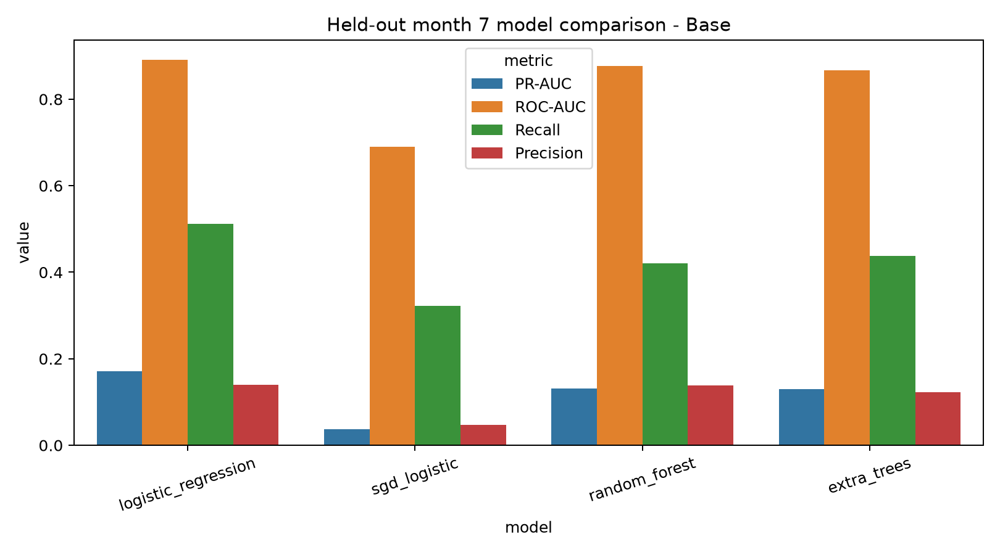
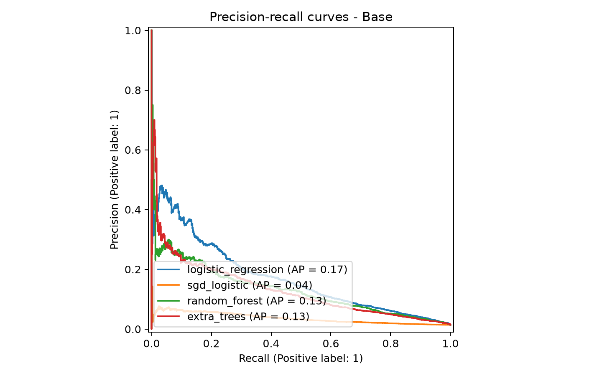

# Evaluation

`results` points to the existing `outputs/` directory. Run `python evaluation/evaluate.py` to print the
selected model and held-out metrics for every BAF dataset.

## Find the results

| Dataset | All files | Model comparison | Precision-recall curves |
| --- | --- | --- | --- |
| Base | [Open results](../outputs/base/) | [View chart](../outputs/base/model_comparison.png) | [View chart](../outputs/base/precision_recall_curves.png) |
| Variant I | [Open results](../outputs/variant_i/) | [View chart](../outputs/variant_i/model_comparison.png) | [View chart](../outputs/variant_i/precision_recall_curves.png) |
| Variant II | [Open results](../outputs/variant_ii/) | [View chart](../outputs/variant_ii/model_comparison.png) | [View chart](../outputs/variant_ii/precision_recall_curves.png) |
| Variant III | [Open results](../outputs/variant_iii/) | [View chart](../outputs/variant_iii/model_comparison.png) | [View chart](../outputs/variant_iii/precision_recall_curves.png) |
| Variant IV | [Open results](../outputs/variant_iv/) | [View chart](../outputs/variant_iv/model_comparison.png) | [View chart](../outputs/variant_iv/precision_recall_curves.png) |
| Variant V | [Open results](../outputs/variant_v/) | [View chart](../outputs/variant_v/model_comparison.png) | [View chart](../outputs/variant_v/precision_recall_curves.png) |

The complete profiling evidence is in [outputs/profiling](../outputs/profiling/), and the consolidated run
record is [outputs/TRAINING_RUN_LOG.md](../outputs/TRAINING_RUN_LOG.md).

### Base model comparison preview

### Base precision-recall preview

